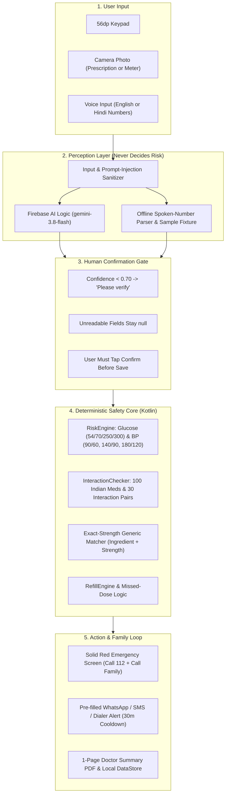

# SehatSaathi

SehatSaathi is an Android app and browser preview for older adults in India who take daily medicines for blood sugar and blood pressure, and for the family members who help care for them.

> **Important:** SehatSaathi is a support tool, not a doctor. In an emergency call 112. Always ask your doctor or pharmacist.

---

## Try it in 60 seconds

1. **On an Android phone:** Download [`docs/SehatSaathi-debug.apk`](./docs/SehatSaathi-debug.apk) (or download it from [`https://shuvamjana1-ops.github.io/Sehat_SaThi/`](https://shuvamjana1-ops.github.io/Sehat_SaThi/)). Open the app and tap **Try demo** to open Sunita Devi's sample profile (age 67, Type-2 Diabetes and Hypertension, 4 daily medicines, 30 days of readings, and 2 linked family members).
2. **In a browser:** Open [`https://shuvamjana1-ops.github.io/Sehat_SaThi/`](https://shuvamjana1-ops.github.io/Sehat_SaThi/) to try the interactive preview without installing anything.
3. **Test a safety boundary:** Go to **Log**, type `54`, `250`, or `300` for blood sugar (or `180/120` for blood pressure), tap **Review & confirm**, and then tap **Save reading**. Open the **Why this result** box to see the exact rule that fired.

---

## Why we built this

Clinic visits in India often last less than 10 minutes. For the next 30 to 90 days, an older parent is at home managing four to eight tablets a day across changing brand names.

Three things regularly go wrong at home:
1. **Duplicate medicines by accident:** A doctor writes a new brand name on a prescription, and the patient keeps taking the old brand too, not realizing both tablets contain Glimepiride or Telmisartan.
2. **Quiet nighttime emergencies:** A blood sugar reading of `54 mg/dL` at 2 AM or a blood pressure reading of `180/120 mmHg` gets written in a paper notebook instead of triggering clear first-aid steps and a call to family.
3. **AI chatbots guessing at medicine safety:** General-purpose chatbots sometimes invent drug interactions or give unsafe dosing advice.

We built SehatSaathi around one strict boundary: **AI only reads and explains. Deterministic code makes every safety decision.**

---

## How it works in 4 steps

1. **Take a photo of your prescription, or type your medicines in.**
   Gemini (`gemini-3.8-flash`) reads handwritten or printed prescriptions and glucometer photos. Every field has a confidence score. Anything below `0.70` is marked **Please verify**, unreadable fields stay empty, and nothing is saved until you confirm it.
2. **Check for duplicate active ingredients and interactions.**
   Fixed Kotlin lookup tables check our bundled 100-medicine Indian dataset (`sample_drugs_dataset.json`) for duplicate active salts, 30 drug-drug interaction pairs (`Avoid`, `Caution`, `Monitor`), and lower-cost Jan Aushadhi generic options that match both active ingredient and exact strength.
3. **Log blood sugar and blood pressure with clear rules.**
   You can type on large 56dp buttons, speak in English or Hindi, or photograph a meter. Fixed clinical rules check your reading (`< 54`, `54 to 69`, `70 to 249`, `250 to 299`, and `>= 300 mg/dL` for blood sugar; `< 90/60`, `140/90`, and `>= 180/120 mmHg` for blood pressure) and show the exact rule that fired.
4. **Keep track of tablet stock and keep family in the loop.**
   When you mark a dose **Taken**, your tablet count goes down by one dose and warns you when 3 or fewer days remain. If you tap **Skip**, your tablet count does not change, and the app never tells you to double your next dose. When a reading is dangerous, SehatSaathi opens a solid red emergency screen (`Call 112` and `Call Family`) and prepares a WhatsApp or SMS message for your consented caregiver.

---

## What SehatSaathi cannot do

We want judges and users to know the exact limits of this project:

- **It is not a doctor.** It never diagnoses conditions, never prescribes medicines, and never tells you to start, stop, or change a dose. Every warning ends with *"Ask your doctor or pharmacist."*
- **The bundled medicine list is a 100-medicine sample.** `sample_drugs_dataset.json` covers 100 common Indian medicines and 30 interaction rules (`verified: false`). Any medicine not in that list is explicitly labeled **Unknown: verify with pharmacist**, never marked safe.
- **Family alerts require a final tap on your phone.** To avoid paid SMS gateways or background servers, WhatsApp, SMS, and phone alerts open your phone's native app with the message pre-filled for you to send.
- **Camera and microphone quality depend on your phone.** Glare on foil blister strips or background noise in a busy room can lower recognition accuracy, which is why the manual keypad is always available on the same screen.

---

## Architecture



---

## How to run and test the project

### Prerequisites
- JDK 17+ and Android SDK (API 35)
- Node.js 20+ (for the deterministic safety evaluation script)
- No API key is needed to run Demo Mode or the test suite. If you want to test live Gemini calls outside Firebase AI Logic, see `.env.example` for the optional `GEMINI_API_KEY` placeholder.

### Commands
```bash
# 1. Run the deterministic clinical safety evaluator (70 checks -> writes docs/ACCURACY_REPORT.md)
npm run evaluate

# 2. Run all 51 Android JUnit & Robolectric tests
gradle :app:testDebugUnitTest

# 3. Run the combined QA check (evaluator + unit tests)
npm run qa

# 4. Build the debug APK
gradle :app:assembleDebug
```

---

## Typography and color tokens

- **Font:** `Manrope` (`Regular`, `Medium`, `SemiBold`, `Bold`, `ExtraBold`) with tabular numerals (`tnum`) enabled on all readings, doses, dates, and rupee amounts.
- **Colors:**
  - Deep Ocean: `#0B4F6C`
  - Clinical Blue: `#0E6E8C` (with `#FFFFFF` button text)
  - Mist: `#E8F1F5`
  - White: `#FFFFFF`
  - Ink: `#16262E`
  - Semantic status colors (`#1F7A4C` Normal, `#B45309` Caution, `#B42318` Urgent, `#991515` Emergency) are used only on health status badges and are always paired with an icon and a text label.

---

## About the team (Needs your input)

To keep this repository honest, we have not invented team bios or contact details. Before final submission, fill in your real details below:

- **Team / Builder Name:** `[Needs your input: Your name or team name]`
- **Why you started this project:** `[Needs your input: 2 to 3 sentences about a family member or real experience that motivated SehatSaathi]`
- **Contact Email / GitHub:** `[Needs your input: Your real email or GitHub profile link]`

---

## Documentation in this repository

- [`docs/craft/AUDIT.md`](./docs/craft/AUDIT.md): Human craft audit and fix log
- [`docs/perfection/BASELINE.md`](./docs/perfection/BASELINE.md): Perfection pass baseline metrics
- [`docs/perfection/FINAL_REPORT.md`](./docs/perfection/FINAL_REPORT.md): Gate-by-gate verification report
- [`docs/perfection/OPEN_ISSUES.md`](./docs/perfection/OPEN_ISSUES.md): Open issues and physical phone checklist
- [`docs/ACCURACY_REPORT.md`](./docs/ACCURACY_REPORT.md): Deterministic safety evaluation report (`70/70` checks passing)
- [`docs/PPT_OUTLINE.md`](./docs/PPT_OUTLINE.md): 10-slide presentation outline
- [`docs/VIDEO_SCRIPT.md`](./docs/VIDEO_SCRIPT.md): 2:45 demo video script with click paths
- [`docs/JUDGE_QA.md`](./docs/JUDGE_QA.md): Answers to 15 common judge questions
